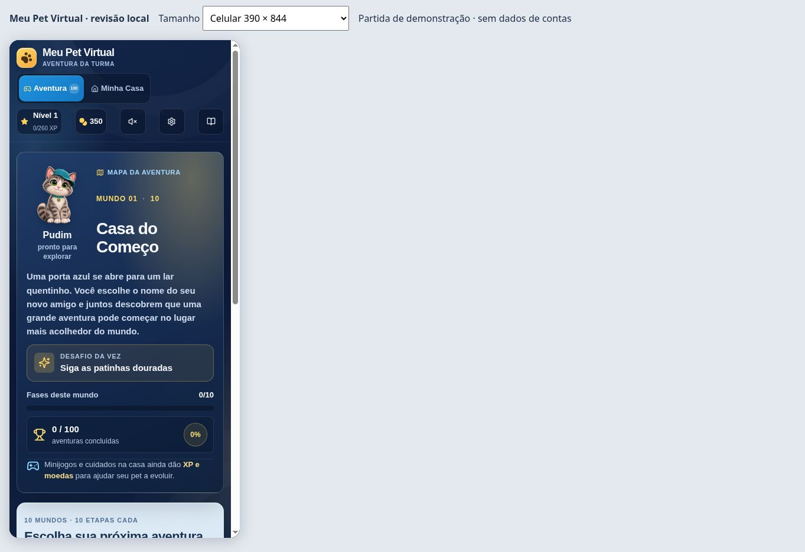

# Meu Pet Virtual — Web Agência AD

## Estado atual da fonte

Versão de produto em preparação: **1.11.0**, vinte salas em dois biomas, portais automáticos, mestres e cartas raras utilizáveis. O piloto foi declarado concluído por David em 16/10. O contador interno do Sites é separado da versão exibida no jogo. Consulte `docs/evolution/state.json` e o relatório apontado por `latest_report` para o status de publicação.

Use `node scripts/build-sites-release.mjs` (ou `pnpm build`): restaura e confere os atlas dos amigos pelo manifesto SHA256, executa Vite e prepara `out/`, preservando os recursos públicos recuperados. As credenciais de servidor não pertencem à configuração pública do cliente. Não trocar o projeto/domínio nem substituir a configuração de autenticação para ajustar animação.

A cobertura de fonte/recuperação evoluiu desde o snapshot v8 abaixo; painel de conta e atlas de ícones foram reconciliados. Testes offline e inspeção estática de sprites não substituem teste de gameplay. A expansão dos amigos está autorizada para David testar no celular depois da publicação.

## Histórico da recuperação

Ramo de retomada e revisão móvel de 09/10/2026, preparado para colaboração com o Manus.

**Comece por [Retomada e instruções para o Manus](recovery/RETOMADA-MANUS.md).**

O projeto reúne o código React/TypeScript recuperado, as 158 mídias da publicação e uma cópia íntegra da distribuição v7. A fonte recuperada é anterior à v7; as diferenças de ícones e painel de conta estão documentadas e ainda precisam ser conciliadas.

- `pnpm dev`: cliente de desenvolvimento.
- `/qa-review.html`: demonstração local da aventura, sem contas nem partidas reais.
- `pnpm check`: verificação TypeScript.
- `pnpm build`: build do código editável, ainda sujeito à conciliação.
- `pnpm build:recovery`: gera `out/` preservando a v7 e aplicando somente as correções móveis desta revisão.
- `pnpm dev:server`: fluxo anterior com Express.

A revisão móvel foi publicada como versão 8 em 09/10/2026. As alterações de entrada da Aventura de 12/10/2026 estão somente na fonte editável e aguardam validação visual e conciliação com os recursos publicados. Não publicar o build normal antes dessas verificações. O build de recuperação não inclui o novo componente de entrada.

- `node --import tsx scripts/verify-adventure-entry.ts`: verifica seleção da próxima fase, replay e imutabilidade do progresso, sem navegador ou conta. Não executa as fases.
- `docs/evolution/state.json` e `docs/evolution/runs/2026-10-12.md`: estado e limites da revisão.

Os 100 estágios ainda precisam de testes reais na conta de teste.

